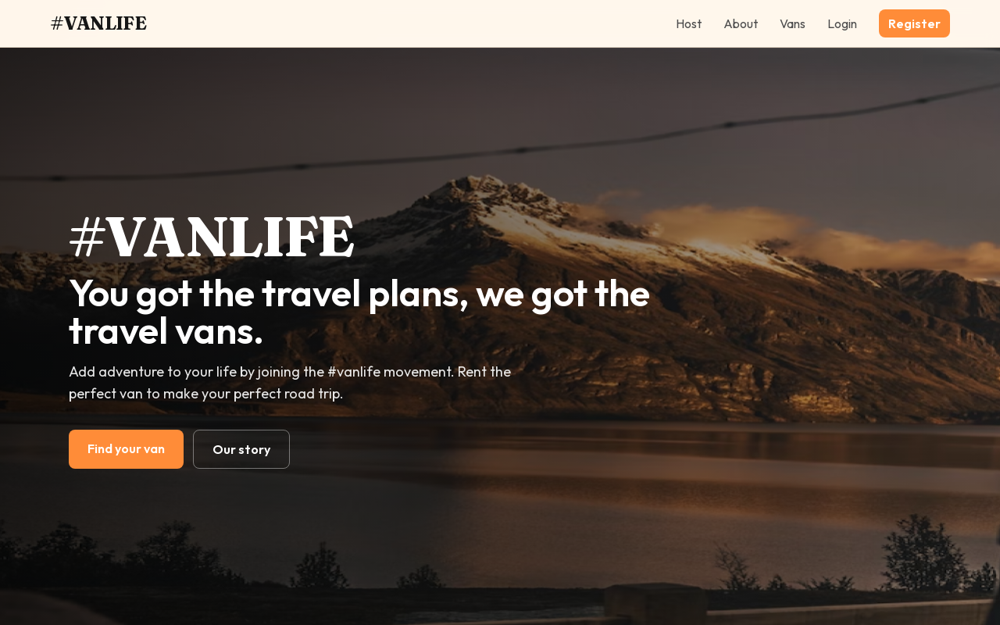
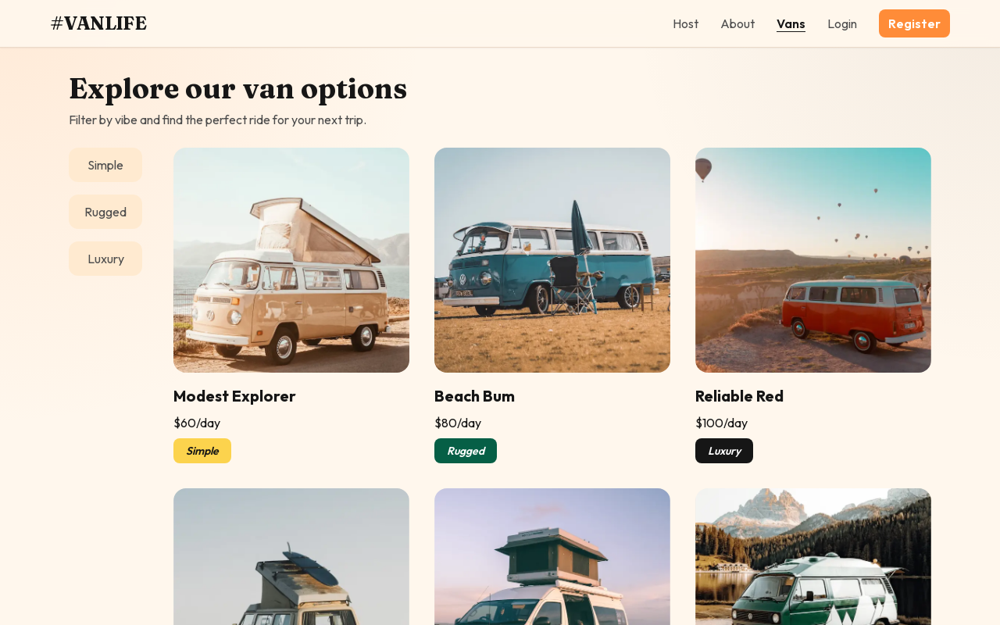
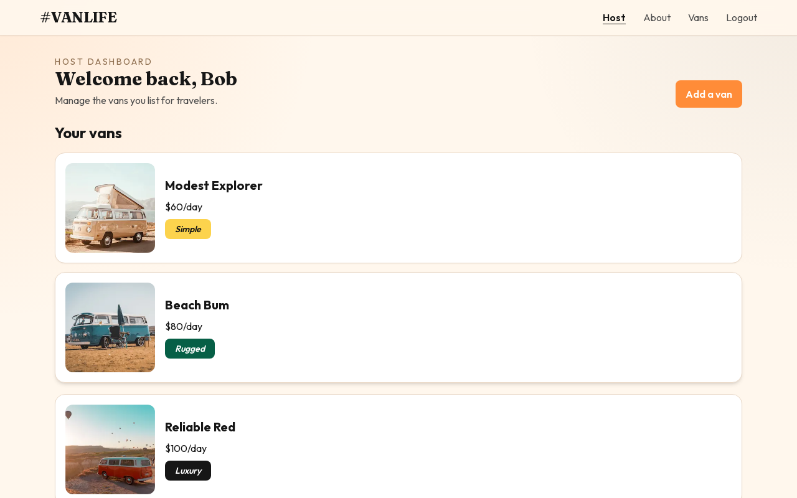

# #VanLife

A travel van rental demo built with the Next.js App Router. Browse vans, filter by type, sign in as a host, and manage your listings — all in a self-contained Next.js app (no external API required).

## Features

- Public home, about, and vans catalog with type filters (`simple`, `rugged`, `luxury`)
- Van detail pages with empty / not-found / error handling
- Credentials auth via NextAuth (login + register)
- Protected `/host` routes (middleware)
- Host dashboard: list, create, edit, and delete your vans
- Responsive UI with loading states

## Tech stack

- **Next.js 13** (App Router)
- **React 18**
- **NextAuth** (credentials provider)
- **Tailwind CSS**
- **Formik + Yup** for forms
- In-memory demo store (resets on server restart)

## Screenshots

<!-- Screenshots are added in docs/screenshots after local verification -->

| Home                               | Vans                               | Host                               |
| ---------------------------------- | ---------------------------------- | ---------------------------------- |
|  |  |  |

Mobile home:


## Getting started

### Prerequisites

- Node.js 18+ and npm

### Setup

```bash
git clone <this-repo>
cd vans-life-next
cp .env.example .env.local
npm install
npm run dev
```

Open [http://localhost:3000](http://localhost:3000).

### Environment variables

| Variable          | Description                                                   |
| ----------------- | ------------------------------------------------------------- |
| `NEXTAUTH_SECRET` | Secret used to sign NextAuth JWTs (`openssl rand -base64 32`) |
| `NEXTAUTH_URL`    | App URL, e.g. `http://localhost:3000`                         |

See `.env.example` for a template. Never commit real secrets.

### Demo accounts

| Email              | Password      | Owned vans                               |
| ------------------ | ------------- | ---------------------------------------- |
| `bob@example.com`  | `password123` | Modest Explorer, Beach Bum, Reliable Red |
| `jane@example.com` | `password123` | Dreamfinder, The Cruiser, Green Wonder   |

Or create a new account at `/register`.

## Scripts

```bash
npm run dev           # development server
npm run build         # production build
npm run start         # start production server
npm run lint          # ESLint
npm run format        # Prettier write
npm run format:check  # Prettier check
npm run qa:smoke      # Playwright smoke (app must be running on :3000)
```

> `qa:smoke` expects `npm run dev` (or `npm start`) on `http://localhost:3000`.

## Project structure

```
app/           # App Router pages + API routes
components/    # Shared UI
lib/           # Seed data + in-memory store
public/        # Static assets (van images, heroes)
```

## Notes

- Host routes under `/host` require authentication.
- Listing data lives in memory for the demo; restarting the server resets creations/edits/deletes to the seed set.
- `vans-life.zip` (old Laravel backend dump) was removed from the repo intentionally.
